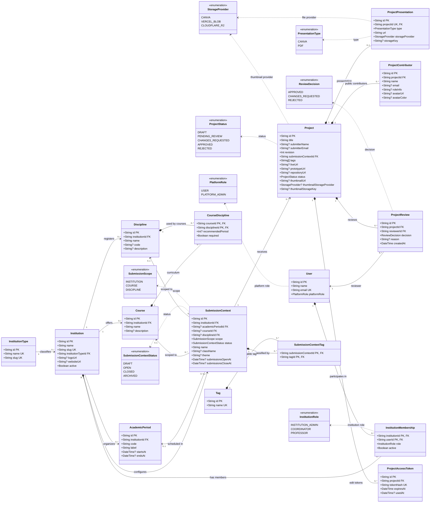

# Diagrama de classes do banco de dados

## Regras do fluxo

- O estudante não precisa de conta para criar uma submissão.
- O professor precisa estar autenticado para avaliar.
- `CHANGES_REQUESTED` significa que o estudante pode corrigir e reenviar.
- O token de correção é salvo somente como hash e expira em 72 horas.
- Ao reenviar, o token anterior é invalidado.
- A aprovação ou rejeição definitiva invalida tokens pendentes.
- O arquivo físico fica no provider indicado em `storageProvider`; o Neon guarda apenas URL e metadados.
- Cada projeto pertence obrigatoriamente a um `SubmissionContext`; a instituição é determinada por esse contexto.
- Um usuário pode participar de várias instituições por meio de `InstitutionMembership`, com papel e ativação próprios em cada uma.
- Cursos, disciplinas e períodos acadêmicos são cadastros próprios da instituição; seus nomes e códigos são únicos apenas dentro dela.
- `CourseDiscipline` descreve a grade curricular, mas não é obrigatório para instituições que não organizam trabalhos por curso e disciplina.
- `SubmissionContext` pode ter escopo institucional, de curso ou de disciplina e concentra turma, tema e janela de recebimento.
- O status de `SubmissionContext` controla se aquele contexto está recebendo projetos; o período acadêmico é apenas uma referência temporal opcional.
- No escopo `INSTITUTION`, `courseId` e `disciplineId` ficam vazios.
- No escopo `COURSE`, `courseId` é obrigatório e `disciplineId` fica vazio.
- No escopo `DISCIPLINE`, `disciplineId` é obrigatório; `courseId` é opcional quando a disciplina é compartilhada por vários cursos.
- O período acadêmico é opcional para permitir mostras contínuas, anuais ou sem divisão por semestre.
- Quando curso, disciplina ou período forem informados, todos devem pertencer à mesma instituição do `SubmissionContext`.
